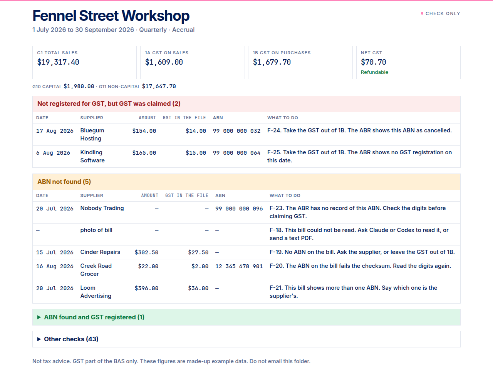
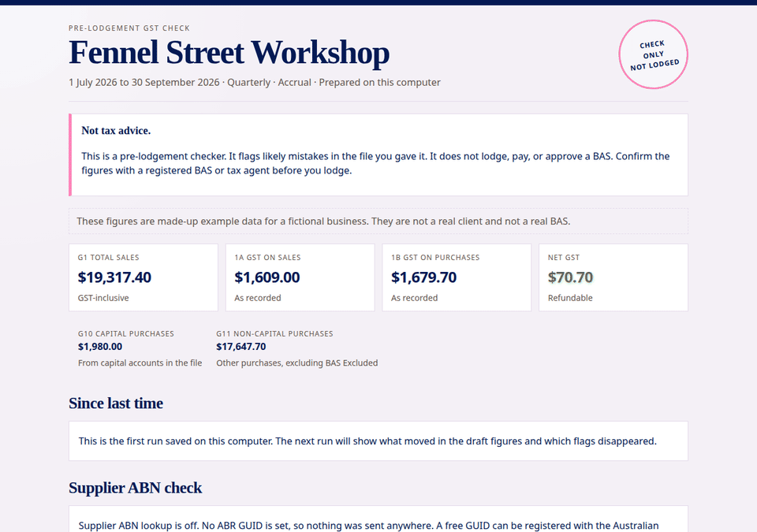

# bas-gst-check

Open this folder in Claude Code or Codex (File, Open Folder, then this folder). You do not download anything else and you do not use a terminal. Then type `Set up BAS GST check`.

Check a quarter of GST figures before the BAS is lodged, and see the likely mistakes. This is the GST part of the BAS only.





The picture uses the Pooja K preset: a white page, navy text, and a little pink. Until you choose a brand, the report uses the paper-and-ink default. **Every name, amount and ABN in the example is made up.** Fennel Street Workshop is not a real business.

This copy is private for now. Do not publish the repository. The licence, when you do share it, is MIT.

## Start here

If the app says Python is missing, it should try `python3`. On a Mac, install Python from python.org if neither `python` nor `python3` works. On Windows, install Python from python.org and tick "Add python.exe to PATH".

Type:

```text
Set up BAS GST check
```

It asks one question at a time: the business name, quarterly or monthly, cash or accrual, branding is asked after the first report (the Pooja K preset, your own colours and logo, or skip), whether to use the example or your own export, and whether you have an ABR GUID. You can skip the GUID.

Then type:

```text
Run the BAS check on the example data
```

Open `output/bas-gst-check.html`. The same flagged lines are in `output/flagged-items.csv` if you want them in a spreadsheet.

When a line is dealt with, type:

```text
Mark flag F-01 as fixed. Note: recoded the bank fee and set the GST to zero.
```

or:

```text
Mark flag F-04 as ignored. Note: tax invoice is on file and the GST is correct.
```

Use the id from the report you are looking at. The same line keeps the same number next time. Notes stay in a folder on this computer (`.local/`). This checker uploads nothing. A photo or PDF that Claude or Codex reads is sent to that AI company. Do not zip this folder and email it.

## What the report shows

The picture above is the made-up example with the made-up ABR answers, so each supplier section has a row. A run without a GUID does not call the ABR. It says once that GST registration could not be checked.

- The business, the period, and one row for **G1**, **1A**, **1B** and net GST. **G10** and **G11** sit on the line under that.
- **Not registered for GST, but GST was claimed.** The ABR says there is no GST registration, or the ABN is cancelled, and the file still has GST on that bill.
- **ABN not found.** No ABN on the bill, or the page could not be read.
- **ABN found and GST registered.** The count only. Open it if you want the list.
- Without a GUID, the first section is **Couldn't check GST registration**.
- Everything else (the one-eleventh check, GST-free wording, duplicates, dates, tax invoices over $82.50, capital purchases, unknown codes, and since last time) is under **Other checks**, folded shut.
- One footer line: not tax advice, GST part of the BAS only, and do not email this folder.

The draft uses the amounts in the file. It does not silently rewrite them. GST adjustments such as bad debts or private use are not included. Cash basis means the file should be amounts you received or paid in the period. Accrual basis means invoices and bills for the period. The tool does not invent a second date.

## Get the file out of the accounting program

Use the same dates as the BAS, and the same cash or accrual basis you lodge on.

**Xero.** Open the Reporting menu, choose All reports, and search for Account Transactions. Set the dates. Under More, choose Cash or Accrual to match the BAS. Update the report, then export it to Excel. [Xero: report settings, including export](https://central.xero.com/s/article/Select-contents-and-display-order-in-a-new-report).

**MYOB.** Open Reporting, then GST/Tax, and run the GST detail report for the period (accrual/invoice or cash/payments, matching the BAS). Export that report. You can also export the sales and purchases journals from Settings, Import and export data, Export. [MYOB: GST reports](https://www.myob.com/au/support/myob-business/reporting/gst-tax-reports). [MYOB: export options](https://www.myob.com/au/support/myob-business/import-export/exporting-data/export-options).

**QuickBooks Online.** Go to Reports, Standard reports, and search for GST Details or BAS Detail. Set the From and To dates. Choose Export/Print, then Export to Excel. [QuickBooks: export a report to Excel](https://quickbooks.intuit.com/learn-support/en-au/help-article/report-management/export-reports-excel-quickbooks-online/L7iAoP97n_AU_en_AU). [QuickBooks: BAS detail report](https://quickbooks.intuit.com/learn-support/en-au/help-article/tax-reports/bas-detail-report/L9212o1SU_AU_en_AU).

Excel files (`.xlsx`) are read directly. If one will not open, in Excel choose File, Save As, and pick CSV.

Made-up samples, not real businesses, are in `examples/exports/`.

## Your file

Use JSON, CSV or Excel. Each row needs a date, whether it is a sale or a purchase, a contact, a description, an account, a net amount, a GST amount, and a tax code. Debit and credit columns are fine when there is also a tax column. A supplier ABN column is optional. The ABN that matters is the one printed on the bill.

Tax codes it understands include the Xero names (GST on Income, GST on Expenses, GST Free, BAS Excluded, Input Taxed, GST on Capital), the MYOB short names (GST, FRE, N-T, CAP, INP, EXP) and the QuickBooks names (GST, GST Free, Out of Scope). A code it does not know is listed in the report and left out of the draft. That is a warning, not a nil BAS.


The made-up quarter is `examples/fennel-street-workshop.json` (1 July 2026 to 30 September 2026). `examples/fennel-street-workshop.csv` is the same quarter. The JSON file already names the period. For a CSV, say which dates the file covers.

## What each check means

**GST is not one-eleventh.** On a taxable line, GST should be one-eleventh of the GST-inclusive amount (net plus GST), rounded to the nearest cent. The review tolerance is in `config/rules.toml` (five cents unless you change it). A GST amount on a GST-free, input-taxed or BAS Excluded code is flagged too.

**GST on things that usually have none.** Bank account fees, interest, wages, super, ASIC annual review fees, and many basic foods (plain milk, bread, flour, uncooked rice) usually should not carry GST. Prepared meals often should. The note tells you which group matched. This is a prompt to look, not a ruling.

**No GST on a usually taxable expense.** Rent, software, advertising, electricity and similar purchases are often taxable. The flag appears when the code says GST-free or input-taxed. It is correct if the supplier is not registered for GST.

**BAS Excluded, but it looks like a real sale or expense.** BAS Excluded drops the line off the BAS. That fits wages, super, drawings and transfers. It does not fit a workshop fee or a toner purchase.

**Possible duplicate.** Same date, contact, description and amounts as another row. Two genuine supplies can look like this. The suggestion is to delete only the extra copy.

**Outside the period.** The date is not inside the quarter or month you named. Cash basis cares about when money moved. Accrual basis cares about the invoice or bill date, or the payment if that came first.

**Tax invoice to have on file.** A purchase that claims a GST credit and costs **more than $82.50 including GST**. $82.50 exactly does not need a tax invoice; a receipt is enough. The tool cannot see your documents. It is a reminder list, not proof that the invoice is missing.

**Capital purchase, G10 or G11.** Equipment and similar assets over the threshold (default $1,000 including GST) that are sitting on an expense account. The ATO expects capital items costing more than $1,000 at G10 when capital purchases are not already recorded separately. Repairs, hires and leases are not capital. The draft leaves the line where the account put it and asks you to move it if it really is an asset.

**The bill itself.** If you point at a folder of bills, each file is read for an ABN printed next to the word ABN. You get a plain warning when there is no ABN, the number fails the checksum, the page shows more than one ABN, the picture cannot be read, or the bill does not match a purchase. A number is never guessed.

**ABR confirmation** (only when a GUID is saved). For an ABN that was actually read from a bill, the tool asks the free ABR whether it is active and the supplier was GST-registered on that date. A timeout is reported as "could not check", and the line is not treated as a failed ABN. Saved answers sit in `.local/` so the same ABN is not looked up on every run.

A tax code the tool does not recognise is left out of the draft totals and listed, so a strange code cannot quietly disappear.

## Optional: ABN check

The ABN check does one job. It reads the supplier's ABN off the bill itself (the word ABN and the 11 digits, or a QR code that is that number). It does not guess. If you have saved a free ABR GUID, it then asks the Australian Business Register only whether that ABN is active and the supplier was registered for GST. That catches a GST credit claimed from a supplier who is not registered, or whose ABN is cancelled.

It is optional. In Claude Code or Codex, type:

```text
Do you already have an ABR GUID? (yes / no, help me get one / skip for now)
```

If you skip, the report keeps this note: ABN check is off: say "set up ABN check" to turn it on. You can type that any time.

If you need a GUID, the app will walk you through the free ABR form. Start at the [web services registration page](https://abr.business.gov.au/Documentation/WebServiceRegistration), accept the agreement, and complete the form at [ABN Lookup registration](https://abr.business.gov.au/Tools/WebServicesRegister). The form asks for your name, an email address, the type of applicant, your state or territory, and a short note on how you will use it. The GUID arrives by email. Come back and type:

```text
add my ABR GUID
```

Paste the key when asked. It is saved only in `my-settings.toml` on this computer (that file is not committed). The app then checks the key with one lookup of the Tax Office's own public ABN and tells you, in plain words, whether it worked. The key is not repeated back to you.

**Which bill files work best.** A text PDF is the surest: the program can read it on its own. Scanned PDFs, JPG and PNG photos, HEIC pictures from a phone, and QR codes on a bill are clearest when Claude or Codex looks at the page (they can read those files). Say:

```text
Check the bills in this folder
```

If a bill has no ABN, the number fails the checksum, the page shows several ABNs, the picture cannot be read, or the bill does not match a purchase, the report says so in the ABN sections, and the CSV lists the same lines. Nothing is guessed. Hard bills are remembered in `.local/abn-learning.json` on this computer, including an ABN you confirm by hand. Bill pictures are never stored in the project.

The sample bills in `examples/bills/` are made up. Their ABNs pass the checksum so the check can be tried, and they are not real businesses. The tests never call the ABR. They replay saved fictional answers.

## Not tax advice

This is a pre-lodgement checker. It is not tax advice, and it does not lodge or pay a BAS. Confirm the figures with a registered BAS or tax agent before you lodge.

The dollar thresholds live in [`config/rules.toml`](config/rules.toml). The report links to the ATO pages used for G1, 1A, 1B, G10, G11, tax invoices, GST-free supplies, and cash versus accrual accounting.

## For developers

Python 3.11 or newer. The check itself uses the standard library.

```bash
pip install -e ".[dev]"
python -m pytest
python -m bas_gst_check run --example
python scripts/check_public_safe.py
gitleaks detect --source . --config .gitleaks.toml --no-banner
```

`my-settings.toml`, `my-brand/` and `my-templates/` override the defaults and are not committed. A full HTML shell can be replaced with `my-templates/report.html.tpl` (`$title`, `$css`, `$body`). Extra CSS goes in `my-templates/extra.css`.

## Licence

MIT. Copyright (c) 2026 Pooja K. See [LICENSE](LICENSE).
